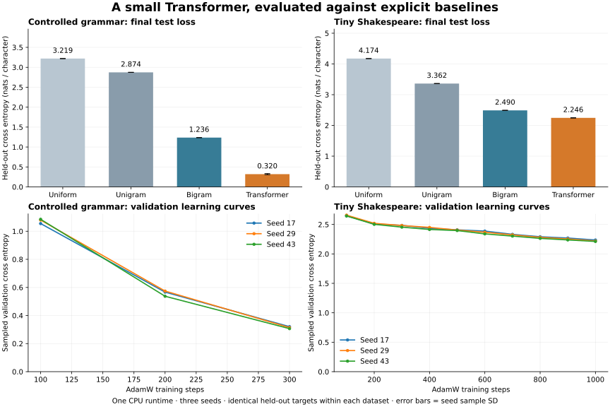
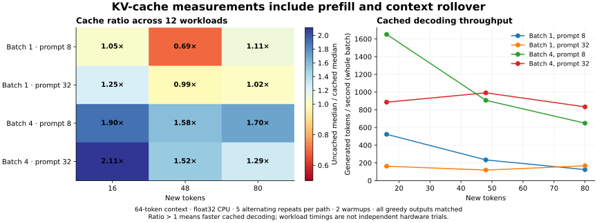

# Comparative evaluation

Measured on 2026-10-18 in the standalone checkout. This study expands the
earlier smoke experiment with explicit statistical baselines, real text,
teacher-forced prediction diagnostics, free-running generation and a cache sweep.
All settings and step budgets were fixed before final test scoring. Raw scores,
per-seed variation, source/data hashes and every generated sample are retained.



## Final held-out results

Loss is cross entropy in nats per character; lower is better. Perplexity is
character perplexity, not word/token perplexity from subword language models.
Transformer uncertainty below is sample standard deviation across three seeds,
not a confidence interval. Transformer columns are means of per-seed metrics.
Baselines are fitted once to training data only.

| Dataset | Predictor | Cross entropy | Perplexity | Bits / character | Top-1 accuracy |
| --- | --- | ---: | ---: | ---: | ---: |
| Controlled grammar | Uniform | 3.2189 | 25.000 | 4.644 | — |
| Controlled grammar | Unigram | 2.8736 | 17.701 | 4.146 | 16.08% |
| Controlled grammar | Bigram | 1.2362 | 3.443 | 1.784 | 50.62% |
| Controlled grammar | Untrained Transformer (mean) | 3.2517 | 25.837 | 4.691 | 1.87% |
| **Controlled grammar** | **Trained Transformer** | **0.3201 ± 0.0128** | **1.377** | **0.462** | **87.33%** |
| Tiny Shakespeare | Uniform | 4.1744 | 65.000 | 6.022 | — |
| Tiny Shakespeare | Unigram | 3.3620 | 28.846 | 4.850 | 14.60% |
| Tiny Shakespeare | Bigram | 2.4895 | 12.056 | 3.592 | 27.07% |
| Tiny Shakespeare | Untrained Transformer (mean) | 4.1997 | 66.664 | 6.059 | 2.50% |
| **Tiny Shakespeare** | **Trained Transformer** | **2.2455 ± 0.0045** | **9.445** | **3.240** | **33.89%** |

Uniform accuracy is omitted because all classes tie. Other predictor ties choose
the lowest vocabulary ID. Accuracy measures next-character prediction given
the correct prefix; it does not measure free-running passage correctness.

## What the measurements show

- **Controlled grammar:** the trained Transformer has 74.1% lower mean cross entropy than the smoothed bigram model on the same held-out targets.
- **Tiny Shakespeare:** the trained Transformer has 9.8% lower mean cross entropy than the smoothed bigram model on the same held-out targets.

The grammar study reproduces the earlier per-seed final losses. The text study
adds evidence on natural-language character prediction, with a small model and
a short training budget. Neither study supports a general-purpose LLM quality
claim, standard benchmark ranking or comparison with subword model perplexities.

## Per-seed evidence

| Dataset | Seed | Test loss | Perplexity | Accuracy | Training wall seconds |
| --- | ---: | ---: | ---: | ---: | ---: |
| Controlled grammar | 17 | 0.330586 | 1.3918 | 86.73% | 25.13 |
| Controlled grammar | 29 | 0.323809 | 1.3824 | 87.30% | 27.13 |
| Controlled grammar | 43 | 0.305795 | 1.3577 | 87.96% | 25.53 |
| Tiny Shakespeare | 17 | 2.242957 | 9.4212 | 34.03% | 99.71 |
| Tiny Shakespeare | 29 | 2.250672 | 9.4941 | 33.63% | 105.21 |
| Tiny Shakespeare | 43 | 2.242906 | 9.4207 | 34.01% | 77.45 |

Training wall time includes periodic sampled validation and checkpoint writes.
It was measured on a shared local CPU and is not a hardware throughput claim.

## Data and protocol

| Dataset | Training characters | Validation characters | Test targets | Vocabulary | Steps / seed | Parameters |
| --- | ---: | ---: | ---: | ---: | ---: | ---: |
| Controlled grammar | 9,507 | 1,183 | 1,213 | 25 | 300 | 72,448 |
| Tiny Shakespeare | 1,003,854 | 55,770 | 55,769 | 65 | 1,000 | 75,008 |

Both datasets use context 64, width 64, two decoder blocks, four heads, MLP 128,
dropout 0.1 and tied embeddings. Training uses AdamW, batch 16, learning rate
0.001, weight decay 0.05, gradient clipping 1.0 and seeds 17, 29, 43.
Validation curves use four fixed sampled batches (4,096 targets) every 100
steps; those sampled losses are not the full held-out test metric.

The generated grammar has 384 unique complete sentences, split into 307 / 38 /
39 sentences after a fixed seeded shuffle. Sentence identities are disjoint,
but all partitions share the same narrow vocabulary and grammar.

Tiny Shakespeare is fetched from [Karpathy’s char-rnn data](https://github.com/karpathy/char-rnn/tree/370cbcd448eb7daf32f21a6be560b70e0b33c4e3/data/tinyshakespeare).
The full downloaded text is SHA-256 verified, then split contiguously by
character offsets: first 90% train, next 5% validation, final 5% test. This is
a custom split, not a claim to reproduce a published benchmark protocol.
It does not hold out entire plays or speakers; motifs and characters can
occur in multiple partitions. The corpus stays in ignored `runs/` and is not
redistributed in the repository or packages. Its URL, revision and digest are
recorded in the report. All held-out characters occur in the training vocabulary.

Uniform, unigram and first-order character bigram models use the same training
vocabulary. Unigram/bigram counts use Laplace smoothing with alpha 1.0.
The Transformer scores every held-out next-character target once, resetting
context every 64 targets. The bigram needs only the previous character and
scores the exact same targets. No test metrics choose checkpoints or settings.

## Generation behavior

For the grammar dataset, 16 fixed color/subject prompts are completed per seed
with greedy and sampled decoding. Sampling uses temperature 0.8, top-k 10 and
top-p 0.95 with explicit prompt-specific seeds. Generation stops at newline or
64 new characters. A valid completion must exactly match a sentence in the
384-sentence grammar. “Unseen” means valid but absent from the training split;
counts below are completions, not distinct sentence identities.

| Strategy | Valid grammar / 48 completions | Valid unseen / 48 |
| --- | ---: | ---: |
| Greedy | 22/48 (45.8%) | 4/48 |
| Sample | 25/48 (52.1%) | 5/48 |

Low teacher-forced loss does not guarantee valid free-running sentences. The
mechanical grammar check makes that gap visible instead of relying on selected
good-looking examples. All 96 grammar completions are retained in the raw report.

Natural-text samples use three predetermined prompts and both greedy/sampled
decoding, 160 new characters, and the same sampling settings. Below are the
seed-17 ROMEO prompt outputs, chosen by protocol rather than output quality.

**Greedy**

```text
ROMEO:
That the the the the the the the the the the the the the the the the the the the the the the the the the the the the the the the the the the the the the the the
```

**Sample**

```text
ROMEO:
Sor, shend wand the heat,
Wit athis, the at my ave the thearth burer
Tir thit thind he mands and ould somer fitherd.


HUTIO:

Shise mam hing so mastel ily ise
```

These short samples are qualitative diagnostics. No human quality ratings,
semantic consistency scores or translation claims are supplied.

## Cache workload sweep



The seed-17 grammar model is measured at batch 1/4, prompt length 8/32 and
16/48/80 new tokens: 12 configurations. Each path has two warmups and five
alternating measured repeats. Timings include prefill. Ratios below 1 mean
the cached path was slower. Every cached/uncached greedy comparison passed.

| Batch | Prompt tokens | New tokens | Rollover | Uncached median ms | Cached median ms | Ratio |
| ---: | ---: | ---: | --- | ---: | ---: | ---: |
| 1 | 8 | 16 | no | 32.09 | 30.60 | 1.049× |
| 1 | 8 | 48 | no | 142.23 | 205.24 | 0.693× |
| 1 | 8 | 80 | yes | 715.38 | 644.82 | 1.109× |
| 1 | 32 | 16 | no | 122.93 | 98.43 | 1.249× |
| 1 | 32 | 48 | yes | 398.63 | 403.55 | 0.988× |
| 1 | 32 | 80 | yes | 489.58 | 477.69 | 1.025× |
| 4 | 8 | 16 | no | 73.58 | 38.75 | 1.899× |
| 4 | 8 | 48 | no | 333.88 | 211.71 | 1.577× |
| 4 | 8 | 80 | yes | 837.17 | 493.43 | 1.697× |
| 4 | 32 | 16 | no | 152.59 | 72.24 | 2.112× |
| 4 | 32 | 48 | yes | 293.96 | 193.62 | 1.518× |
| 4 | 32 | 80 | yes | 494.56 | 384.11 | 1.288× |

This sweep measures one process, CPU environment and small model. Timing samples
are not independent hardware trials; no confidence intervals are asserted.
Batch throughput counts all generated tokens in the batch. Cache overhead can
outweigh saved work for small workloads; learned-position rollover rebuilds
the complete context. Do not compare these CPU timings directly with the
different model/workload in the earlier [GPU validation](CUDA_VALIDATION.md).

## Reproduce and inspect

```bash
python -m pip install -e ".[dev,plots]"
python scripts/run_evaluation_study.py --output runs/evaluation-study --grammar-steps 300 --text-steps 1000 --seeds 17 29 43
python scripts/plot_evaluation_study.py --report runs/evaluation-study/study.json --output runs/evaluation-study/figures
```

The full study downloads Tiny Shakespeare from the pinned upstream URL.
Use `--datasets grammar` for a study requiring no external corpus or download.
Reports contain training settings, vocabulary sizes, split/source hashes, runtime
metadata, per-seed predictions, learning curves, samples and all cache timings.
Archived JSON and SVG text use canonical UTF-8/LF line endings; measured values
are unchanged. One CPU thread and deterministic Torch algorithms are used. Exact numerical
replay across different runtime/hardware stacks is not promised.

[Complete JSON record](experiments/evaluation-study.json) ·
[Data/figure checksums and plotting versions](experiments/evaluation-study-manifest.json) ·
[Original grammar experiment](EXPERIMENTS.md) · [GPU checks](CUDA_VALIDATION.md)
